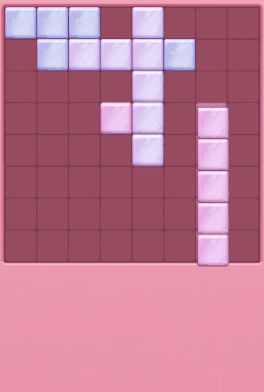

# AutoBlockBlast

AutoBlockBlast runs on a Mac and plays **Block Blast on a USB-connected Android phone**. Use it to preview the bot's suggested placements or let it play automatically. It reads the board and tray from a scrcpy video stream, searches the legal placements for the visible pieces, and verifies the result after every ADB drag.

## Autoplay preview

A short recording of the bot playing on a Samsung Galaxy A72.



## Tested setup

| Component | Tested configuration |
| --- | --- |
| Host | Apple silicon Mac with Python 3.12 |
| Phone | Samsung Galaxy A72 at 1080 × 2400, connected over USB with ADB |
| Video | scrcpy server v3.2, decoded at 360 × 800 |
| Game | Android Block Blast, with blue and pink screenshot fixtures |

Other Android devices may need board, tray and drag calibration. The tested setup covers Android. Support for additional game themes and device layouts depends on validation.

The default solver searches every legal order and position for the pieces it can see. It favors any all-clear in a plan that uses the tray, then the number of placements that clear lines, the total lines cleared, and space for future pieces. Clear counts approximate the game's combo and scoring behavior.

## Setup

1. Install Python 3.10+ and Android Platform Tools (`adb`).
2. Enable USB debugging on the Android phone, connect it to the Mac, and authorize the Mac on the phone. Open Block Blast and keep it in the foreground.
3. Download the **scrcpy v3.2 server** and save it as `scrcpy/scrcpy-server` inside the checkout. The configured version must match the download. [scrcpy v3.2 release](https://github.com/Genymobile/scrcpy/releases/tag/v3.2)
4. Set up the project:

```bash
git clone https://github.com/BagusKrishna/AutoBlockBlast.git
cd AutoBlockBlast
python3 -m venv .venv
source .venv/bin/activate
pip install -e .
python -m autoblockblast.check_setup
```

Calibration is device-specific. Run `python -m autoblockblast.calibrate` and inspect the detected board and pieces before enabling autoplay. Drag gain and pickup offsets in `src/autoblockblast/config.py` also need to match the device; the GUI does not calibrate those values.

## Run

```bash
# Read the board and print a plan without touching the phone
.venv/bin/python -m autoblockblast.autoplay

# Play continuously; press Control+C to stop
.venv/bin/python -m autoblockblast.autoplay --execute --moves 0

# Play at most three moves
.venv/bin/python -m autoblockblast.autoplay --execute --moves 3

# Compare a faster swipe using a bounded run
.venv/bin/python -m autoblockblast.autoplay --execute --moves 3 --drag-ms 500 --timing
```

On macOS the `scripts/` folder also contains launchers for preview, start and stop. An in-progress drag can finish before stop takes effect. The phone screen must remain unlocked and Block Blast must remain in front.

The most recent failed verification is stored locally in `captures/last-failure/`. Its JSON report records the intended move and the predicted and observed state. Raw game frames are stored when available. Restarting the bot keeps the report until a later verification failure replaces it. Preview saves a board overlay. Pass `--debug` to also save successful before/after frames. The capture directory is gitignored.

Use `--solver beam` to compare the original ranking or `--solver beam-all-clear` to compare width-40 beam search using the new ranking.

## Troubleshooting

- **No fresh, stable game state.** Keep the game visible, dismiss any overlays, and wait for animations to settle. Run preview to check the board and tray before resuming autoplay.
- **Board or tray mismatch.** Open `captures/last-failure/transition.json` to inspect the expected and observed states. Keep any accompanying images local.
- **Changes appear missing.** Run the command from the `AutoBlockBlast` checkout that contains this README. The original `blockblast-vision-bot` checkout has a separate entry point.

## Tests

```bash
python -m unittest discover -s tests -v
python -m autoblockblast.solver
```

The tests cover known screen patterns, tray verification and the exact solver. See [architecture](docs/ARCHITECTURE.md), [Android validation results](docs/ANDROID-IMPLEMENTATION-PLAN.md), and [branch workflow](docs/BRANCHING.md).

## Attribution

This project started from [anishrtech/blockblast-vision-bot](https://github.com/anishrtech/blockblast-vision-bot) and has been adapted with device-specific calibration, verification, tests, and planning changes. Check the upstream project's licensing before redistributing its code; no license grant was found in the upstream checkout.
